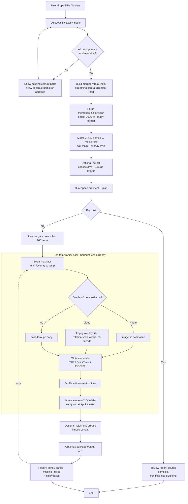
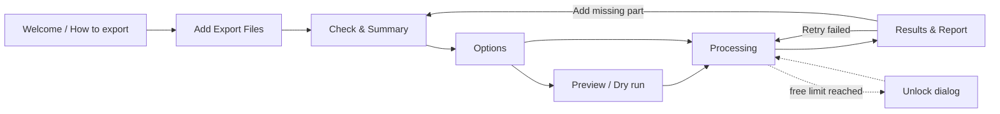

# Software Requirements Specification
## Memories Rescue *(working title, final name TBD)*: Local Snapchat Memories Export Repair Tool for Windows and macOS

| Field | Value |
|---|---|
| Document ID | NBW-MR-SRS-001 |
| Version | 0.1 (Draft for public review) |
| Date | 2026-10-16 |
| Author / Owner | Adam Goodman, NovaByteWorks |
| Status | Draft |
| Standard | Structured after IEEE 830-1998 and ISO/IEC/IEEE 29148:2018 |
| Contact | support@novabyteworks.com |

> **Disclaimer.** Memories Rescue is an independent product by NovaByteWorks. It is **not affiliated with, endorsed by, or sponsored by Snap Inc.** "Snapchat", "Memories" and "My Eyes Only" are trademarks of Snap Inc. and are used here only to describe compatibility. The app only works on data that users have exported themselves through Snap's official "Download My Data" feature.

> **Public document notice.** This SRS is published on GitHub. It contains no secrets, credentials, product or license IDs, customer data, or non-public information about competitors. Competitor information is limited to what their public web pages say (see §2.7 and References).

---

## Table of Contents
1. [Introduction](#1-introduction)
2. [Overall Description](#2-overall-description)
3. [Data Formats](#3-data-formats)
4. [Processing Pipeline](#4-processing-pipeline)
5. [Functional Requirements](#5-functional-requirements)
6. [Non-Functional Requirements](#6-non-functional-requirements)
7. [User Interface: Screens and Flows](#7-user-interface-screens-and-flows)
8. [Error Handling](#8-error-handling)
9. [Licensing and Payment Flow](#9-licensing-and-payment-flow)
10. [Packaging, Distribution and Updates](#10-packaging-distribution-and-updates)
11. [Test Plan](#11-test-plan)
12. [Risks and Mitigations](#12-risks-and-mitigations)
13. [Milestones](#13-milestones)
14. [Out of Scope](#14-out-of-scope)
15. [Open Questions](#15-open-questions)
16. [References](#16-references)
- [Appendix A: Requirements Traceability](#appendix-a-requirements-traceability)

---

## 1. Introduction

### 1.1 Purpose
This document sets out the software requirements for **Memories Rescue** (working title), a desktop app for Windows and macOS. It repairs a user's own Snapchat "Download My Data" Memories export on the user's computer. The SRS is the agreed baseline for design, building, testing and release. It is written for the developer, future contributors, testers and technically minded users who want to know exactly what the app does with their data.

### 1.2 Product Scope
When users download their Snapchat Memories, the files they get are hard to use:
- media files have no capture date or GPS location embedded;
- text and sticker overlays come as separate PNG files;
- large libraries are split across several ZIP files;
- long videos may be split into ~10-second clips.

Memories Rescue takes the export ZIPs or extracted folders and produces a clean, date-sorted library (`YYYY/MM/`) with:
- correct embedded capture dates and GPS;
- correct file timestamps;
- optionally, overlays burned in and split clips joined back together.

Photo libraries such as Apple Photos, Google Photos and Windows Photos can then import the result and show it on the right date and on the map.

**Goals**
- G1: Reliable on very large libraries (100 GB / 50,000 items) without running out of memory.
- G2: Every processed photo and video carries correct capture time and, where available, location, including **video GPS that Apple Photos reads for its map**.
- G3: Jobs can be paused and resumed, and failed items can be retried without starting over.
- G4: Everything runs on the user's machine. No media, metadata or login details ever leave it.
- G5: Clear, honest messaging about what the app can and cannot recover.

**Non-goals** are listed in §14.

**Context and timing.** Snapchat has announced Memories storage changes from **January 2027**. Memories older than one year that fall outside the oldest 5 GB will be archived as thumbnails, and users will need a paid storage plan or a download to open them. The same rule then applies every year [R5]. Many users are expected to export their Memories before that date, so the target launch is **before December 2026** (§13).

### 1.3 Definitions, Acronyms and Abbreviations

| Term | Definition |
|---|---|
| **Export** | The data package a user requests at accounts.snapchat.com → My Data, delivered as one or more ZIP files. |
| **Part** | One ZIP file of a multi-part export. The primary part has no suffix; extra parts have `-2`, `-3`, … suffixes. |
| **Memory / Item** | One saved snap: a photo or video, with an optional overlay. It counts as **one item** for licensing. |
| **Main file** | The base media file, `…-main.jpg` or `…-main.mp4`. |
| **Overlay** | A transparent PNG (`…-overlay.png`) holding the caption, stickers or drawing the user added. |
| **Composite** | A new output file with the overlay rendered on top of the main media. |
| **2026 format** | The current export layout: media is bundled in `memories/`, and URL fields in JSON are often empty or `N/A` [R3][R6]. |
| **Legacy format** | The older export layout: `memories_history.json` holds signed, time-limited CDN download URLs and no media is bundled [R3][R4]. |
| **Clip rejoin** | Joining consecutive ~10 s video segments (common for 2017–2021 recordings) back into one video. |
| **Job** | One processing run over a set of input parts, with its own persistent state. |
| **Dry run** | A preview run that analyses the input and reports planned output without writing any media. |
| **EXIF** | Exchangeable Image File Format metadata in JPEG/HEIC. |
| **QuickTime atoms / Keys** | MP4/MOV metadata boxes. Here this means `mvhd`/`tkhd` creation time and `mdta` keys such as `com.apple.quicktime.creationdate` and `com.apple.quicktime.location.ISO6709`. |
| **ISO 6709** | String format for geographic points, e.g. `+40.7128-074.0060/`. |
| **HEVC** | H.265 video codec. Some Windows machines can't play it without a paid or optional extension. |
| **LGPL ffmpeg** | An ffmpeg build configured without `--enable-gpl`/`--enable-nonfree`. |
| **Tauri** | A Rust-based desktop app framework that uses the operating system's own web view. |
| **Sidecar** | An external binary (ffmpeg, exiftool) shipped inside the app bundle and run as a child process. |
| **MEO** | My Eyes Only, Snapchat's passcode-protected Memories folder. |
| **SHALL / SHOULD / MAY** | Requirement keywords as in RFC 2119: mandatory / recommended / optional. |

### 1.4 References
See §16. In-text citations use the form [Rn].

### 1.5 Document Overview
- §2 describes context, users and constraints.
- §3–4 define the input formats and the processing pipeline.
- §5–6 list the testable requirements.
- §7–10 cover UI, errors, licensing and distribution.
- §11–15 cover verification, risk, schedule, scope limits and open items.

---

## 2. Overall Description

### 2.1 Product Perspective
Memories Rescue is a stand-alone desktop app. It is not a Snapchat client and does not connect to Snapchat. It has no Snapchat login, uses no Snap API, and makes **no network requests to Snap servers in v1**. Snap's support guidance says it does not allow third-party apps that use a user's Snapchat login [R7], and the app is designed to stay well clear of that.

In v1 the app makes only these network requests, and the user can see all of them:
1. Gumroad license verification, only when a key is entered or re-checked (§9).
2. Update checks against the NovaByteWorks update feed (§10). The user can turn this off.
3. Opt-in anonymous crash/usage counts, **off by default** (NFR-PRV-04).

### 2.2 Product Functions (summary)
- Accept several export ZIPs and/or extracted folders by drag-and-drop or file picker.
- Check that all parts are present and readable, and merge them into one logical export.
- Parse `memories_history.json` in both the 2026 and legacy formats.
- Pair main and overlay files by their filename ID.
- Embed capture date/time and GPS into photos (EXIF) and videos (QuickTime atoms/Keys).
- Set file modification times to the capture time.
- Optionally burn overlays into composites, keeping originals if the user wants.
- Optionally rejoin consecutive ~10 s clips.
- Write a `YYYY/MM` folder tree, optionally packed as a ZIP.
- Keep resumable job state, show progress and ETA, check free disk space before starting, and offer a dry-run preview.
- Produce a report of missing and failed items, with retry.
- Free tier (first 100 items), then a one-time lifetime unlock.

### 2.3 User Classes and Personas

| Persona | Description | Key needs | Tech skill |
|---|---|---|---|
| **P1 "Archive-before-January" (primary)** | Age 20–35, 5–10 years of Memories (10–100 GB), wants everything safely in Apple/Google Photos before the 2027 storage change. | Reliability on huge exports, correct dates, map locations, resume after sleep or crash. | Low–medium |
| **P2 "Switcher"** | Leaving Snapchat or deleting the account. Wants a permanent, tidy archive on an external drive. | Date-sorted folders, originals kept, ZIP output, a complete report. | Medium |
| **P3 "Memory keeper"** | Parent or family member helping someone else, often on Windows. | Simple wizard, plain language, HEVC playback guidance. | Low |
| **P4 "Power user"** | Has tried scripts or open-source tools [R2] and hit their limits. | Dry run, logs, re-run of failed items only, predictable file naming. | High |

### 2.4 Operating Environment
- **macOS** 12 Monterey or later, Apple silicon (arm64) and Intel (x64), as one universal binary.
- **Windows** 10 (22H2) and 11, x64. Windows on ARM: x64 emulation is best-effort (see Q-07).
- Minimum hardware: 8 GB RAM, dual-core CPU, free disk space as reported by the precheck (FR-28).
- Input and output may be on internal or external drives (APFS, HFS+, NTFS, exFAT). FAT32 is warned against because of its 4 GB file limit.

### 2.5 Design and Implementation Constraints

| ID | Constraint |
|---|---|
| C-01 | **Local-only processing.** No media or metadata may be sent anywhere. |
| C-02 | **No Snapchat credentials and no contact with Snap servers** in v1 [R7]. |
| C-03 | Solo developer. Architecture must favour small surface area, existing proven tools (ffmpeg, exiftool) and automated tests. |
| C-04 | Bundled ffmpeg **must be an LGPL-compliant build**: no `--enable-gpl`, no `--enable-nonfree`. Dynamically linked or run as a separate sidecar process, with license text, source offer and build configuration published (§10.4). This means GPL encoders such as libx264/libx265 are **not** available (see §4.4). |
| C-05 | Metadata writing uses exiftool (sidecar) **or** a native Rust EXIF/MP4 library. The choice is made in M1 (Q-02). Whichever is used must handle JPEG EXIF, MP4/MOV `mvhd`/`tkhd` times and Apple `mdta` Keys. |
| C-06 | Framework: **Tauri 2 (Rust) preferred.** Electron is the fallback (§2.5.1). |
| C-07 | Payments and licenses go through the **existing Gumroad license-key flow**. No in-house payment handling. |
| C-08 | Release builds must be code-signed: Apple Developer ID plus notarization; Windows Authenticode. |
| C-09 | UI strings are externalised (i18n-ready) from day one. English ships first. |

#### 2.5.1 Framework Tradeoff: Tauri vs Electron

| Criterion | Tauri 2 (preferred) | Electron (alternative) |
|---|---|---|
| Installer size | Small (~10–20 MB before sidecars), because it uses the OS web view | Large (~80–120 MB), bundles Chromium |
| Memory at idle | Low | Higher (Chromium + Node) |
| Core language | Rust: strong fit for streaming ZIP, hashing and job state with predictable memory use | Node.js: workable, but you have to manage streams carefully to keep memory bounded |
| Rendering consistency | Differs between WKWebView (macOS) and WebView2 (Windows). Needs cross-platform UI testing | Same Chromium everywhere |
| Sidecar support | Built in (`externalBin`), with scoped shell permissions | `child_process` works but has no built-in scoping |
| Updater | Official updater plugin with signed update manifests | electron-updater, mature |
| Security model | Capability/permission allowlist by default | Hardening has to be set up by hand (contextIsolation, sandbox) |
| Ecosystem maturity | Smaller, younger | Very large, mature |
| Developer familiarity risk | Higher if Rust is less familiar | Lower |
| WebView2 dependency | Needs the WebView2 runtime on Windows 10. The installer must bootstrap it | None |

**Decision:** Tauri 2, unless a blocker is found in the M1 spike (e.g. WebView2 deployment, sidecar signing or notarization). If one is found, switch to Electron with the same Rust/Node core boundaries.

### 2.6 Assumptions and Dependencies
- A1: Users can request and download their own export from accounts.snapchat.com → My Data, ticking **Export your Memories** and **Export JSON Files**, with date range **All Time**. Delivery can take up to 7 days [R1].
- A2: Export download links appear to expire after roughly 3 days, so users must download promptly [R2]. The app's onboarding says this.
- A3: The 2026 export bundles media under `memories/` with filenames of the form `YYYY-MM-DD_<id>-main.<ext>` and an optional `-overlay.png` [R3][R4][R6].
- A4: `json/memories_history.json` contains a `Saved Media` array whose fields include `Date` (UTC), `Media Type` and `Location`. The URL fields are often empty or `N/A` in the 2026 format [R3][R6].
- A5: Snap may change the export format without notice. The parser must be tolerant and versioned (RISK-01).
- A6: My Eyes Only content is **not** included in the export unless the user moves it out of MEO before requesting the export. The app cannot recover it (§14).
- A7: Gumroad's license verification endpoint stays available. Offline tolerance covers outages (§9).
- A8: ffmpeg's built-in decoders handle the codecs found in exports (H.264, HEVC, AAC). Encoding uses platform hardware encoders or OpenH264 (§4.4).

### 2.7 Market Context (public information only)

| Product (public page) | Public price / model | Notes from public pages |
|---|---|---|
| MemoriesExport | $9.99 one-time; first 100 free | Cloud, desktop and browser options |
| SnapEasy | $9.99 | Advertises clip rejoining |
| ExportSnaps (desktop) | $14.99; ~200 free | Desktop app |
| SnapSavior | $7 | Shown as paused at time of writing [R3] |
| andrefecto/Snapchat-Memories-Downloader | Free, open source | Browser-based, uses ffmpeg.wasm [R2] |

**Gaps this product targets:**
- reliability on huge libraries;
- video GPS that shows on the Apple Photos map;
- resume and retry of only the failed items;
- clip rejoin;
- honest messaging (e.g. clearly stating that MEO is excluded and that expired legacy URLs cannot be recovered).

---

## 3. Data Formats

> Examples below are **illustrative**, built from public descriptions [R3][R4][R6]. They contain no real user data. Field names and value formats have changed over time, so the parser **SHALL** treat every field as optional and tolerate unknown fields (FR-10).

### 3.1 Export Package Structure

```
mydata~1729000000000.zip            ← primary part
├── index.html
├── html/
│   └── memories_history.html
├── json/
│   ├── memories_history.json
│   └── … (other account JSON, ignored)
└── memories/
    ├── 2019-07-04_3F2A9C1E-…-main.mp4
    ├── 2019-07-04_3F2A9C1E-…-overlay.png
    ├── 2021-12-25_A81B…-main.jpg
    └── …
mydata~1729000000000-2.zip          ← additional part(s): mostly memories/
mydata~1729000000000-3.zip
```

- The primary part contains `json/`, `html/` and `memories/`. Later parts mainly contain more `memories/` files.
- Part names follow the base name with `-2`, `-3`, … suffixes. Browsers can change names (e.g. `(1)`), so part detection **SHALL** use file contents (presence of `json/memories_history.json`, overlapping base names) as well as filenames.

### 3.2 Filename Patterns

| Pattern (regex) | Meaning |
|---|---|
| `^(\d{4}-\d{2}-\d{2})_([A-Za-z0-9-]+)-main\.(jpg\|jpeg\|png\|mp4\|mov)$` | Main media. Group 1 = date (export-provided, UTC calendar date), group 2 = item ID |
| `^(\d{4}-\d{2}-\d{2})_([A-Za-z0-9-]+)-overlay\.png$` | Overlay for the same item ID |
| `^(\d{4}-\d{2}-\d{2})_([A-Za-z0-9-]+)\.(jpg\|mp4)$` | Variant without a `-main` suffix (tolerated) |
| Anything else in `memories/` | Logged as "unrecognised" and copied to `_unsorted/` if the user chooses |

The ID is matched exactly and case-insensitively. Main and overlay **SHALL** be paired on `(date, id)` (FR-12).

### 3.3 `memories_history.json`: 2026 Format (illustrative)

```json
{
  "Saved Media": [
    {
      "Date": "2021-12-25 18:42:07 UTC",
      "Media Type": "Image",
      "Location": "Latitude, Longitude: 51.50735, -0.12776",
      "Download Link": "",
      "Media Download Url": "N/A"
    },
    {
      "Date": "2019-07-04 21:03:55 UTC",
      "Media Type": "Video",
      "Location": "Latitude, Longitude: 0.0, 0.0",
      "Media Download Url": ""
    }
  ]
}
```

### 3.4 `memories_history.json`: Legacy Format (illustrative)

```json
{
  "Saved Media": [
    {
      "Date": "2018-05-12 09:15:30 UTC",
      "Media Type": "Video",
      "Location": "Latitude, Longitude: 40.71280, -74.00600",
      "Download Link": "https://<snap-cdn-host>/…?…&sig=<redacted>",
      "Media Download Url": "https://<snap-cdn-host>/…?…&Expires=<redacted>"
    }
  ]
}
```

In the legacy format **no media is bundled**. The URLs are signed and time-limited [R3][R4]. In v1 the app parses legacy JSON for metadata only and reports that the media is not present locally. Downloading from legacy URLs is a separate, **off-by-default, deferred** feature (FR-50, RISK-02).

### 3.5 Field Parsing Rules

| Field | Rule |
|---|---|
| `Date` | Parse `YYYY-MM-DD HH:MM:SS UTC` and tolerate ISO 8601 variants. Store as UTC. If it can't be parsed, use the filename date at 12:00:00 UTC and flag `date_precision=day`. |
| `Media Type` | `Image`/`Photo` → photo; `Video` → video; anything else → infer from the file extension. |
| `Location` | Extract two decimals with the regex `(-?\d+(?:\.\d+)?)\s*,\s*(-?\d+(?:\.\d+)?)`. Treat `0.0, 0.0`, empty, or out-of-range values (`|lat|>90`, `|lon|>180`) as **no location**. |
| `Download Link` / `Media Download Url` | Treat empty, `N/A` or missing as "no URL". Never log full URLs (redact query strings). |

### 3.6 JSON-to-File Matching
In the 2026 format the filename ID may not appear in the JSON. Matching **SHALL** work as follows (FR-11):
1. If a JSON entry carries an ID or URL token that matches a filename ID, match directly (confidence `exact`).
2. Otherwise, group JSON entries and files by `(UTC date, media type)`. Within each group, match by order: JSON time order against file order (ZIP entry order, then ID). Confidence is `ordinal`.
3. If the group sizes differ, match what can be matched, give the unmatched files a day-precision time (date from the filename), and list them in the report as `metadata_partial`.
4. The confidence level is stored per item and shown in the dry-run preview and the report.

### 3.7 Output Layout

```
<Output>/Memories Rescue/
├── 2019/
│   └── 07/
│       ├── 2019-07-04_210355_3F2A9C1E.mp4            ← final (composited if enabled)
│       └── originals/2019-07-04_210355_3F2A9C1E-main.mp4   ← if "keep originals"
├── 2021/12/2021-12-25_184207_A81B.jpg
├── _report/
│   ├── report.html
│   ├── report.csv
│   └── failed_items.json
└── .memories-rescue/job.sqlite                       ← resumable state (FR-33)
```

- Filename template: `{YYYY-MM-DD}_{HHMMSS}_{shortid}.{ext}`, using **local time of capture** where it can be determined (FR-19) and UTC otherwise. Collisions get the suffix `_2`, `_3`, ….
- Rejoined videos: `{date}_{time}_{firstid}_joined.mp4`.

### 3.8 Job State Schema (SQLite, abridged)

```sql
CREATE TABLE job   (id TEXT PRIMARY KEY, created_utc TEXT, app_version TEXT,
                    options_json TEXT, input_fingerprint TEXT, status TEXT);
CREATE TABLE part  (path TEXT, size INTEGER, mtime INTEGER, sha256_head TEXT,
                    role TEXT /* primary|extra */, status TEXT);
CREATE TABLE item  (id TEXT PRIMARY KEY, date_utc TEXT, media_type TEXT,
                    lat REAL, lon REAL, match_conf TEXT,
                    main_part TEXT, main_entry TEXT, overlay_part TEXT, overlay_entry TEXT,
                    stage TEXT /* pending|extracted|tagged|composited|written|done|failed */,
                    attempts INTEGER, last_error_code TEXT, output_path TEXT, output_sha256 TEXT);
CREATE TABLE clip_group (group_id TEXT, item_id TEXT, seq INTEGER);
```

---

## 4. Processing Pipeline

### 4.1 Pipeline Diagram



### 4.2 Streaming and Memory Bounds
- ZIP central directories are read without loading the archive. Entries are extracted one at a time, through a buffered stream, to a per-item temp directory on the **output volume**, so the final move is atomic.
- ZIP64 archives and parts larger than 4 GB are supported.
- The worker pool has a configurable size. Default: `min(physical_cores − 1, 4)` for photos and `min(2, cores/2)` for video re-encodes.
- `memories_history.json` is stream-parsed.
- Temp files are deleted once an item is checkpointed as `done`.

### 4.3 Metadata Writing Details

| Media | Fields written |
|---|---|
| JPEG photo | EXIF `DateTimeOriginal`, `CreateDate`, `OffsetTimeOriginal`, `OffsetTime`; GPS `GPSLatitude/Ref`, `GPSLongitude/Ref`, `GPSDateStamp/TimeStamp` (UTC). |
| PNG photo | eXIf chunk / XMP equivalents. Converted to JPEG only if the user opts in. |
| MP4 / MOV video | `mvhd`/`tkhd`/`mdhd` creation and modification time (UTC); `mdta` Keys `com.apple.quicktime.creationdate` (ISO 8601 with offset) and `com.apple.quicktime.location.ISO6709` (e.g. `+51.5074-000.1278/`); also `©xyz` user-data atom for compatibility. Written as a lossless remux, with no re-encode unless compositing. |
| All outputs | File modification time (and creation time on macOS/Windows where supported) set to the capture instant. |

**Time offset:** the source `Date` is UTC.
- When GPS is present, the local UTC offset is worked out from an **offline bundled timezone boundary dataset** (e.g. timezone-boundary-builder, ODbL), and DST is applied through tzdb.
- When there is no GPS, the offset defaults to the user's chosen "home timezone" (default: system timezone). `OffsetTime*` is set to match.

### 4.4 Video Compositing Details
- Command shape (conceptual): `ffmpeg -i main.mp4 -i overlay.png -filter_complex "[1:v]scale=<W>:<H>[ov];[0:v][ov]overlay=0:0" -c:a copy …`
- **Rotation:** read the display matrix / `rotate` side data, auto-rotate the main video first, then scale the overlay to the *display* dimensions. Remove the rotation flag from the output.
- **Scale/aspect:** if the overlay's aspect ratio differs from the video's by more than 2%, scale to fit width and centre vertically. Log an `overlay_aspect_mismatch` warning.
- **Encoder:** because ffmpeg is LGPL (C-04), use the platform hardware encoders: `h264_videotoolbox`/`hevc_videotoolbox` on macOS, `h264_mf`/`hevc_mf` (Media Foundation) on Windows. Fallback: **OpenH264** (BSD-licensed; Cisco binary under Cisco's terms, or a BSD source build; see Q-04). Default output codec: **H.264** for broad compatibility, with target bitrate matched to the source.
- **HEVC sources:** decoded with ffmpeg's built-in decoder. If "Maximise Windows compatibility" is on, output is H.264 even when no overlay is composited.
- Audio is stream-copied; if that's not possible it is re-encoded to AAC with ffmpeg's native `aac` encoder (LGPL-compatible).

### 4.5 Clip Rejoin Heuristic
Clips are candidates for joining when **all** of the following hold:
- both items are videos;
- capture dates fall within 2017-01-01 to 2021-12-31 by default (configurable, or "all years");
- they have the same resolution, codec and frame rate;
- each clip's duration is ≥ 9.0 s, except the last;
- the gap between the end of one clip and the start of the next is ≤ 2 s (from `Date` + duration);
- they share a location (or both have none).

Groups are shown in the dry-run preview. Joining uses the ffmpeg concat demuxer with stream copy, and re-encodes only if overlays are burned in. Each segment's overlay is applied to its own time span. Originals are always kept when rejoin is on.

---

## 5. Functional Requirements

Each requirement has an ID, a priority (**M** = must for v1.0, **S** = should, **C** = could / later) and acceptance criteria (AC).

### 5.1 Input and Validation

**FR-01 Drag-and-drop and picker input (M).** The user can add any mix of `.zip` files and folders by drag-and-drop onto the main window or with a native file/folder picker. They can add more before starting.
- AC1: Dropping 1–20 ZIPs and/or folders adds every item to the input list within 2 s, without reading the full archive contents.
- AC2: Non-ZIP files show a non-blocking "ignored: not an export file" notice.

**FR-02 Part detection and classification (M).** The system works out which input is the primary part (has `json/memories_history.json`) and which are extra parts. It groups parts that belong to the same export.
- AC1: Given a fixture with primary, `-2` and `-3` parts in any order, all three are grouped into one export, with the primary identified.
- AC2: Renamed parts (e.g. `mydata (1).zip`) are still grouped, using content detection.

**FR-03 Missing-part detection (M).** The system reports gaps in the part sequence (e.g. `-2` and `-4` present, `-3` missing) and missing primary JSON.
- AC1: The fixture with `-3` removed shows "Part 3 appears to be missing" and offers **Add file** or **Continue without it**.

**FR-04 Archive integrity check (M).** Each ZIP's central directory is checked. Truncated or corrupt archives are reported with the affected entries. Entries that can still be read remain usable.
- AC1: A ZIP truncated at 70% is flagged as `PART_TRUNCATED`. Readable entries are processed. Lost entries are listed in the report.

**FR-05 Folder input (M).** Already-extracted exports (folders containing `memories/` and optionally `json/`) are accepted and treated the same as ZIPs.
- AC1: The same fixture as ZIP and as extracted folder gives identical output hashes (ignoring the job ID).

**FR-06 Merge parts into virtual index (M).** All parts are indexed into one logical file set without extracting anything to disk first. Duplicate entries across parts are de-duplicated by name plus size plus CRC32.
- AC1: A 50k-entry, 5-part fixture is indexed in ≤ 60 s on reference hardware, with peak RSS ≤ 1 GB.

**FR-07 Export sanity summary (M).** After indexing, a summary shows: format detected, parts, photo/video/overlay counts, date range, items with location, and total size.
- AC1: Counts match fixture `truth.json` exactly.

### 5.2 Parsing and Matching

**FR-10 Tolerant JSON parsing (M).** `memories_history.json` is parsed in both the 2026 and legacy formats (§3.3–3.5). Unknown fields are ignored and every field is treated as optional. The file is stream-parsed, so a JSON file larger than 100 MB does not need to be fully in memory.
- AC1: Both format fixtures parse with no errors. A fixture with an extra unknown field and a missing `Location` parses with warnings only.
- AC2: A JSON file with a BOM or CRLF line endings parses correctly.

**FR-11 JSON-to-file matching (M).** Entries are matched to media using the algorithm in §3.6. Each item records its match confidence (`exact`/`ordinal`/`none`).
- AC1: In the synthetic fixture with known ground truth, ≥ 99% of items match the correct capture time.
- AC2: Unmatched files still get output with day-precision dates and are listed under `metadata_partial`.

**FR-12 Main/overlay pairing (M).** Main and overlay files are paired by `(date, id)`, even when they sit in different parts.
- AC1: A fixture with the overlay in part 2 and the main file in part 1 pairs correctly.
- AC2: Orphan overlays (no main file) are reported and not output, unless the user opts to export them.

**FR-13 Format detection and messaging (M).** The format is classified as `2026` (media bundled), `legacy` (URLs, no bundled media), `mixed`, or `unknown`, and the UI messaging adjusts to match.
- AC1: A legacy-only export shows: "This export contains links rather than media. These links expire and Memories Rescue v1 does not download them. Please request a new export." The message includes the steps from [R1].

### 5.3 Metadata Repair

**FR-15 Photo date EXIF (M).** For every photo output, EXIF `DateTimeOriginal`, `CreateDate`, `OffsetTimeOriginal` and `OffsetTime` are written (§4.3).
- AC1: `exiftool -DateTimeOriginal -OffsetTimeOriginal` on an output returns values that match the fixture's ground truth (local time and offset).

**FR-16 Photo GPS EXIF (M).** If a valid location exists, GPS latitude/longitude with refs and GPS date/time stamps are written.
- AC1: The output appears on the correct map position (±0.0001°) in Apple Photos (macOS) and Windows Photos/Explorer properties.
- AC2: `0.0, 0.0` locations do not write GPS.

**FR-17 Video creation time (M).** For videos, QuickTime `mvhd`/`tkhd`/`mdhd` creation times (UTC) and `com.apple.quicktime.creationdate` (with offset) are written, without re-encoding.
- AC1: Apple Photos and Google Photos (web upload) show the correct date. `ffprobe` shows `creation_time` equal to the ground-truth UTC.

**FR-18 Video GPS (ISO 6709) (M).** For videos with location, `com.apple.quicktime.location.ISO6709` (mdta Keys) and `©xyz` are written.
- AC1: An imported video appears in the Apple Photos **Places/map** view at the correct location (manual test on macOS 13+, and on iOS through iCloud sync).
- AC2: Remuxed output plays in QuickTime Player and VLC, and its duration matches the source to within 1 frame.

**FR-19 Timezone resolution (M).** Local offset is resolved from GPS using a bundled offline tz boundary dataset, otherwise from the user's home timezone setting. The method used is recorded per item.
- AC1: A 2020-07-01 12:00 UTC item at New York coordinates gets offset −04:00. The same instant in London gets +01:00. With no GPS and home TZ Asia/Kolkata, it gets +05:30.

**FR-20 File timestamps (M).** Output file modification times (and creation/birth time on macOS and Windows) are set to the capture instant.
- AC1: Finder/Explorer "Date Modified" and "Date Created" match the capture time (to the second).

**FR-21 Metadata-only mode (S).** Option to only fix metadata and timestamps (no compositing, no rejoin). This is the fastest path.

### 5.4 Overlays

**FR-23 Photo overlay compositing (M).** When enabled, the overlay PNG is alpha-composited onto the photo with a native image library. The overlay is resized to the photo's displayed dimensions, honouring EXIF orientation. Output is JPEG at quality 92 (configurable), or PNG if the source is PNG.
- AC1: Visual diff against a reference composite: SSIM ≥ 0.98 on fixture images, including rotated (orientation 6/8) samples.

**FR-24 Video overlay compositing (M).** When enabled, the overlay is burned into videos with ffmpeg, handling rotation and scale (§4.4), with audio preserved.
- AC1: Portrait (rotate=90) and landscape fixtures produce correctly oriented composites with the overlay aligned (manual check plus frame-sample SSIM ≥ 0.95 against reference).
- AC2: A/V sync drift ≤ 40 ms over a 60 s video.

**FR-25 Keep originals (M).** Option (default **on**) to also save the untouched main file and overlay under `YYYY/MM/originals/`, with the same metadata fixes applied to the main file.
- AC1: With the option on, every composited item has a matching original. With it off, no `originals/` folder is created.

**FR-26 Overlay mode choice (M).** Overlay handling choices: **Burn in, keep originals** (default), **Burn in only**, **Save overlay as separate file**, **Ignore overlays**.

### 5.5 Clip Rejoin

**FR-27 Optional clip rejoin (S, promoted to M if the schedule allows).** When enabled, groups of consecutive clips are detected (§4.5) and each group is joined into one video. The originals are always kept.
- AC1: Fixture with a 3-clip group (10 s + 10 s + 4 s, 1 s gaps) gives one 24 s ±0.1 s video with metadata from the first clip, and no audible gap at the joins (manual listen plus audio-level check).
- AC2: Unrelated clips that happen to be adjacent (different resolution) are not joined.
- AC3: In the dry-run preview the user can untick individual groups.

### 5.6 Planning, Progress and Output

**FR-28 Disk-space precheck (M).** Before processing, the required space is estimated: final output + originals (if kept) + peak temp (largest item × workers × 2) + optional ZIP. This is compared with free space on the output volume.
- AC1: If free space is less than the estimate × 1.1, a blocking warning shows the shortfall in GB, with options: change destination, disable "keep originals", disable ZIP.
- AC2: Free space is re-checked every 500 items. Processing pauses automatically with `DISK_FULL_IMMINENT` if less than 2 GB is free.

**FR-29 Dry-run preview (M).** The user can run the full analysis (FR-01–FR-13, clip detection, space estimate) without writing media. The preview shows totals, the match-confidence breakdown, sample items with planned output paths, clip groups and warnings.
- AC1: A dry run writes nothing to the output folder except a preview report (if the user exports it). Dry runs are not limited by the free tier.

**FR-30 Date-sorted output (M).** Output goes to `<dest>/Memories Rescue/YYYY/MM/` using the naming template in §3.7. Year/month folders use the resolved local capture date.
- AC1: Every output lands in the folder matching its `DateTimeOriginal`/`creationdate`.

**FR-31 Optional ZIP output (S).** Option to package the output tree into one or more ZIP64 archives. The volume size can be set (default: none; 4 GB option for FAT32 sharing).

**FR-32 Progress and ETA (M).** The UI shows the overall percentage, items done/total, bytes processed, current stage, throughput, and an ETA. The ETA is an exponentially weighted moving average, kept separately for photos and videos.
- AC1: Progress updates at least once per second without blocking the UI. After 10% completion, the ETA is within ±25% of the actual remaining time on the reference fixture.

**FR-33 Resumable job state (M).** Per-item stage is checkpointed to SQLite (WAL mode) after each item. If the app is closed, crashes, the machine sleeps or loses power, the job can be resumed from the last checkpoint without re-processing completed items.
- AC1: Kill the process at random points 20 times during a 5k-item job; each resume finishes with no duplicate or corrupt output files (verified by hash list) and no completed item processed twice.
- AC2: If the input fingerprint changes (a part was replaced), the user is warned and can re-index only that part.

**FR-34 Pause / cancel (M).** The user can pause (finish in-flight items, then stop), resume, or cancel. Cancelling keeps completed output and job state.

**FR-35 Atomic writes (M).** Each output is written to a temp file on the destination volume, fsynced, then renamed into place. Partial files never appear in `YYYY/MM/`.

**FR-36 Prevent sleep (S).** While a job runs, system sleep is prevented: `IOPMAssertion` on macOS, `SetThreadExecutionState` on Windows. Display sleep is still allowed.

### 5.7 Reporting and Retry

**FR-38 Completion report (M).** An HTML and CSV report is produced. It lists per item: status (`done`, `metadata_partial`, `missing_media`, `failed`, `skipped_free_limit`), error code, source part/entry, output path and match confidence. It also includes summary totals and a list of missing parts.
- AC1: Every input media entry and every JSON entry appears in exactly one report row.

**FR-39 Retry failed items (M).** One click re-queues only the `failed` items, optionally with changed settings (e.g. composite off, software encoder).
- AC1: After injecting 5 deterministic failures and then removing the fault, retry processes exactly those 5 items.

**FR-40 Add missing parts later (M).** The user can add a part that was missing to an existing job. Only the newly available items are processed.
- AC1: F-05 job, then add part 3: only part-3 items are processed and the report updates.

**FR-41 Logs and diagnostics (M).** A rotating local log (max 50 MB) with redacted paths (home directory replaced by `~`) and no URLs or query strings. **Export diagnostics** creates a ZIP of logs and the job summary (no media, no JSON content) for the user to attach to a support email.

### 5.8 Licensing

**FR-44 Free tier (M).** Without a license, the first **100 items** of a job are fully processed (in chronological order). The rest are listed as `skipped_free_limit`. Dry run is unlimited.
- AC1: A 250-item fixture without a license produces exactly 100 outputs. After unlocking, resuming processes the remaining 150 without redoing the first 100.

**FR-45 License activation (M).** The user enters a Gumroad license key. It is verified online through Gumroad's license verification API and the result is cached locally (§9).
- AC1: Valid key unlocks; invalid key shows `LICENSE_INVALID`; no network shows `LICENSE_OFFLINE` and the free tier continues.

**FR-46 Offline-tolerant verification (M).** A license that has been verified stays valid offline indefinitely for processing. Re-verification is attempted in the background at most every 30 days, and a failed re-check never blocks a running job. Only an explicit refunded/chargebacked/disabled status from Gumroad revokes the license, after a 14-day grace period.
- AC1: Activated device with network disabled for 90 days (clock-shifted test) still processes without limit.

**FR-47 License management (S).** View license status, deactivate on this device, and a link to the purchase page.

### 5.9 Settings, Help and Deferred Features

**FR-48 Settings (M).** Settings: home timezone, overlay mode, keep originals, clip rejoin (with year range), Windows compatibility (H.264 output), worker count, output template, ZIP output, update checks on/off, anonymous telemetry on/off (default off), language.

**FR-49 Onboarding/help (M).** A built-in guide explains how to request an export:
- accounts.snapchat.com → My Data;
- tick **Export your Memories** and **Export JSON Files**;
- choose **All Time**;
- delivery can take up to 7 days [R1];
- download links may expire in ~3 days [R2];
- My Eyes Only items must be moved out first;
- what the January 2027 storage change means [R5].

The guide also links to support (`support@novabyteworks.com`).

**FR-50 Legacy URL fetch (C, deferred, off by default).** A possible future option to download media from legacy-format signed URLs that have not yet expired. It is **not in v1.0**. If it is ever built, it SHALL:
- be opt-in per job;
- show an explicit warning;
- use only URLs from the user's own export file, with no login and no tokens;
- respect rate limits.

It needs a separate legal and ToS review first (RISK-02, Q-01).

**FR-51 HEVC playback guidance (S).** On Windows, if HEVC sources are found and the system HEVC decoder is missing, the app shows a dismissible notice explaining the playback issue and offering the "Maximise Windows compatibility" (H.264 output) option.

---

## 6. Non-Functional Requirements

### 6.1 Performance

| ID | Requirement | Verification |
|---|---|---|
| NFR-PERF-01 | Handles exports of **100 GB / 50,000 items** across ≥ 10 parts to completion. | Huge-library test H-01 (§11.4) |
| NFR-PERF-02 | Peak memory (RSS, app + sidecars) ≤ **1.5 GB** for any export size. Memory must not grow with item count, beyond the SQLite page cache and index (≤ 300 MB at 50k items). No full ZIP or full JSON load into memory. | Memory profiling over full 100 GB run |
| NFR-PERF-03 | Metadata-only mode throughput ≥ **20 photos/s** and ≥ **5 videos/s** (remux) on reference hardware (Apple M1 8 GB; Windows Intel Core i5 8th gen 8 GB SSD). | Benchmark |
| NFR-PERF-04 | Video composite throughput ≥ **1× realtime** with hardware encoders on reference hardware. | Benchmark |
| NFR-PERF-05 | UI stays responsive (input-to-paint < 100 ms) during processing. | Manual + automated UI timing |
| NFR-PERF-06 | Resume after crash starts processing within 10 s for a 50k-item job. | Test |
| NFR-PERF-07 | Cold start to usable window ≤ 3 s. | Test |

### 6.2 Privacy and Security

| ID | Requirement |
|---|---|
| NFR-PRV-01 | **No media, filenames, metadata, locations or JSON content leave the device.** Verified by network capture during the full test suite: only the endpoints in §2.1 are contacted. |
| NFR-PRV-02 | The app never asks for, stores or handles Snapchat login details, and makes no requests to Snap domains in v1 [R7]. |
| NFR-PRV-03 | Network permissions in Tauri capabilities are allowlisted to the Gumroad license endpoint, the update feed and (if opted in) the telemetry endpoint only. |
| NFR-PRV-04 | Telemetry is **off by default**. If the user opts in, the app sends only anonymous counts: app version, OS family, items processed (bucketed), error-code counts, and crash signatures with paths removed. It sends no identifiers linked to the license, no persistent IP storage, and no content. The full payload can be previewed in Settings. |
| NFR-PRV-05 | The license key is stored in the OS keychain (macOS Keychain / Windows Credential Manager), not in plain-text config. |
| NFR-PRV-06 | Logs and reports are stored only locally. Diagnostics export happens only when the user chooses it, and the user can see what it contains. |
| NFR-PRV-07 | Sidecar binaries are bundled, signed and called with argument arrays (no shell interpolation). Archive entry names are treated as untrusted (path traversal / "zip slip" protection: reject `..`, absolute paths and symlinks in entries). |
| NFR-PRV-08 | Updates are verified with a signature (Tauri updater keys; the private signing key is kept offline and never in the repository). |
| NFR-PRV-09 | Temp directories are deleted on completion, on cancel, and on next start after a crash. |
| NFR-PRV-10 | A plain-language privacy policy is published and linked in the app. |

### 6.3 Reliability

| ID | Requirement |
|---|---|
| NFR-REL-01 | Zero data loss: inputs are **never modified or deleted**. Inputs are opened read-only. |
| NFR-REL-02 | Crash-safe: atomic outputs (FR-35) plus checkpointing (FR-33). Kill tests pass 20/20. |
| NFR-REL-03 | One bad item never stops a job. Per-item failures are isolated. Sidecar timeout = (media duration × 10 + 60 s). |
| NFR-REL-04 | Sidecar crashes are caught, and the item is retried once automatically with safe settings (software decode/encode). |
| NFR-REL-05 | Output verification: every output is re-opened (image decode / `ffprobe`) and its metadata read back before it is marked `done`. |
| NFR-REL-06 | Graceful handling of removable drives being disconnected: the job pauses and resumes once the drive is back. |

### 6.4 Usability and Accessibility

| ID | Requirement |
|---|---|
| NFR-USE-01 | A first-time user can go from launch to a running job in ≤ 5 steps with default settings. Tested with 5 non-technical users: ≥ 4 succeed without help. |
| NFR-USE-02 | All errors use plain language, with a cause and a next step (§8). Raw error codes are shown only as secondary detail. |
| NFR-USE-03 | **Accessibility:** WCAG 2.1 AA for contrast and focus. Full keyboard operation, visible focus. Screen-reader labels (VoiceOver, Narrator/NVDA). Progress announced through ARIA live regions at ≤ 1 update per 10 s. Supports reduced motion and OS dark/light/high-contrast modes. |
| NFR-USE-04 | Honest messaging: the app never claims to recover My Eyes Only, expired links or media missing from the export. The report clearly separates "not in your export" from "failed to process". Marketing copy follows the same rule. |
| NFR-USE-05 | Minimum window size 900×600. Layout works at 200% scaling. |

### 6.5 Internationalisation

| ID | Requirement |
|---|---|
| NFR-I18N-01 | All UI strings are externalised (ICU MessageFormat or Fluent), with plural support. No string concatenation in UI code. |
| NFR-I18N-02 | English ships at v1.0. The layout is prepared for **Spanish, Arabic (RTL mirroring via CSS logical properties) and Portuguese (Brazil)** in later releases. |
| NFR-I18N-03 | Dates and numbers are shown in the user's locale. Filenames and folders always use ISO 8601 numbers. |
| NFR-I18N-04 | Unicode paths are supported (NFC/NFD normalisation on macOS; paths longer than 260 characters on Windows via `\\?\`). |

### 6.6 Portability

| ID | Requirement |
|---|---|
| NFR-PORT-01 | Same feature set on macOS 12+ (universal arm64/x64) and Windows 10/11 x64. |
| NFR-PORT-02 | Platform-specific code (encoders, sleep prevention, file times, keychain) is behind a trait/interface with tests on both platforms in CI. |
| NFR-PORT-03 | Output is portable: importable into Apple Photos, Google Photos (web/desktop upload), Windows Photos and Lightroom with dates intact. |

### 6.7 Legal and Compliance

| ID | Requirement |
|---|---|
| NFR-LEG-01 | The "Not affiliated with Snap Inc." disclaimer appears in the About screen, on the website and in the README. Trademarks are used only to describe compatibility. No Snap logos or look-alike branding. |
| NFR-LEG-02 | ffmpeg LGPL compliance: LGPL-only build, run as a separate process, license text shipped, exact source and build script published, users able to replace the binary [R11]. |
| NFR-LEG-03 | Third-party notices for all dependencies (Rust crates, npm packages, exiftool if used [Perl Artistic/GPL dual license], tz boundary data [ODbL]) are generated automatically into `THIRD_PARTY_NOTICES`. |
| NFR-LEG-04 | Codec patents: rely on OS-provided encoders/decoders where possible. If OpenH264 is used, follow Cisco's binary distribution terms (Q-04). |
| NFR-LEG-05 | A privacy policy and EULA/terms are published. Refunds follow a stated policy on the Gumroad product page. |
| NFR-LEG-06 | No Snapchat credentials and no automated access to Snap services (C-02) [R7]. |
| NFR-LEG-07 | GDPR/CCPA: NovaByteWorks processes no personal data on servers except Gumroad purchase data (Gumroad as merchant/processor) and opt-in anonymous telemetry. |

### 6.8 Maintainability and Supportability

| ID | Requirement |
|---|---|
| NFR-MNT-01 | The parser is versioned (`format_profile`). A new export format can be supported by adding a profile plus a fixture, without changing the pipeline. |
| NFR-MNT-02 | CI on GitHub Actions: lint, unit tests, fixture integration tests on macOS and Windows runners, and signed release builds. |
| NFR-MNT-03 | Support by email at `support@novabyteworks.com`, aiming for a first response within 2 business days. The FAQ covers the top issues (MEO, expired links, HEVC, disk space, missing parts, free limit). |

---

## 7. User Interface: Screens and Flows

### 7.1 Primary Flow



### 7.2 Screens

| # | Screen | Contents | Key actions |
|---|---|---|---|
| S0 | **Welcome** | Short value statement; "Not affiliated with Snap Inc."; illustrated 4-step guide to requesting an export [R1]; warnings about ~3-day link expiry [R2], My Eyes Only, January 2027 [R5]. | Get started; Resume previous job (if any) |
| S1 | **Add Export Files** | Large drop zone; list of added files with size and detected role (Primary / Part 2 …); status badges. | Add files…, Add folder…, Remove, Continue |
| S2 | **Check & Summary** | Format detected; part completeness (missing-part callouts); counts (photos, videos, overlays, with location); date range; total size; warnings. | Add missing part, Continue anyway, Back |
| S3 | **Options** | Destination picker with free-space gauge; overlay mode; keep originals; clip rejoin (year range); Windows compatibility; ZIP output; home timezone. Space estimate updates live. | Preview (dry run), Start |
| S4 | **Preview** | Sample of the planned folder tree; match-confidence breakdown; table of sample items with thumbnail, planned name, date and map pin; clip groups with checkboxes; time and size estimate. | Export preview report, Start, Back |
| S5 | **Processing** | Overall progress bar, items, GB, ETA, throughput; current stage; scrolling recent-items list; counts of warnings and failures; sleep-prevention indicator. | Pause, Resume, Cancel, Open output folder |
| S6 | **Results** | Outcome summary (Done / Partial metadata / Not in export / Failed / Skipped: free limit); explanations; link to `report.html`. | Retry failed, Unlock to finish, Open folder, Export diagnostics, New job |
| — | **Unlock dialog** | Price; what you get; "Buy on Gumroad" (opens browser); license key field; offline note. | Buy, Activate, Later |
| — | **Settings** | As FR-48; telemetry toggle with payload preview; update channel. | — |
| — | **About** | Version, licenses, third-party notices, ffmpeg source link, disclaimer, support email. | — |

### 7.3 UX Principles
- Defaults are safe: keep originals on, inputs read-only, dry run offered prominently.
- Results describe what happened in plain terms. "Not in your export" is never presented as a failure of the app, nor hidden.
- Long jobs: the app shows a system notification when it finishes and keeps progress across restarts.

---

## 8. Error Handling

| Code | Condition | User message (summary) | System behaviour | Recovery |
|---|---|---|---|---|
| `INPUT_NOT_EXPORT` | File is not a ZIP/folder with `memories/` or `json/` | "This doesn't look like a Snapchat export." | Ignore input | Remove / choose another |
| `PART_MISSING` | Gap in part sequence, or no primary | "Part N appears to be missing." | Continue allowed; its items unknown | Add part later (FR-40) |
| `PART_TRUNCATED` | Incomplete download / corrupt central directory | "Part N is incomplete. Re-download it if your link still works." | Use the entries that can be read | Re-download, add again |
| `ZIP_ENTRY_CRC` | CRC mismatch on an entry | "One file in Part N is damaged." | Item failed | Retry; re-download part |
| `JSON_MISSING` | No `memories_history.json` | "Exact times aren't available; using dates from filenames." | Day-precision dates | Add primary part |
| `JSON_PARSE` | Malformed JSON | "The export's data file is damaged; using filenames where possible." | Fallback as above | Report |
| `LEGACY_LINKS_ONLY` | Legacy format, no bundled media | "This export contains links instead of media; please request a new export." | No media processing | Guide to re-export |
| `MATCH_PARTIAL` | JSON/file counts differ for a day | (in report) "Exact time unknown for N items." | `metadata_partial` | None needed |
| `MEDIA_DECODE` | Image/video can't be decoded | "This photo/video can't be read." | Copy original as-is, flag | Retry with safe mode |
| `FFMPEG_FAIL` | ffmpeg non-zero exit / timeout | "Couldn't add the overlay to this video." | Auto-retry once with software path; then output original + separate overlay | Retry failed |
| `ENCODER_UNAVAILABLE` | No hardware encoder and no fallback | "Video overlays need an extra component." | Disable video compositing; metadata still fixed | Settings / Q-04 |
| `METADATA_WRITE` | EXIF/QuickTime write failed | "Couldn't save the date into this file." | Still output with mtime set; flag | Retry |
| `DISK_FULL` / `DISK_FULL_IMMINENT` | Not enough space | "Not enough space on <drive>: need X GB more." | Pause job | Free space / change destination |
| `DEST_UNAVAILABLE` | Output drive disconnected | "The output drive was disconnected." | Pause | Reconnect, resume |
| `PERMISSION_DENIED` | No write access / macOS privacy (TCC) | "Memories Rescue can't write to this folder." | Pause | Choose folder / grant access |
| `PATH_TOO_LONG` | Windows path limit | (handled automatically) | Use `\\?\` prefix; shorten name | — |
| `FREE_LIMIT` | 100 items reached without a license | "You've rescued 100 memories for free. Unlock to finish the rest." | Remaining → `skipped_free_limit` | Unlock and resume |
| `LICENSE_INVALID` | Gumroad says key invalid | "That key wasn't recognised." | No change | Re-enter / contact support |
| `LICENSE_OFFLINE` | No network at activation | "Connect to the internet once to activate." | Free tier continues | Retry later |
| `JOB_STATE_CORRUPT` | SQLite integrity check fails | "Saved progress was damaged; rebuilding from the output folder." | Rebuild state by hashing existing outputs | Automatic |
| `UNKNOWN` | Unhandled error | "Something went wrong with this item." | Item failed; logged | Retry; diagnostics |

---

## 9. Licensing and Payment Flow

### 9.1 Model
- **Free tier:** the first 100 items of any job, fully processed. Unlimited dry runs.
- **Lifetime unlock:** one-time payment, price point **US$9.99–14.99** (final price TBD, Q-05). Covers all v1.x updates and is valid on the buyer's own computers (activation limit TBD, Q-06).
- Sold through the **existing NovaByteWorks Gumroad license-key flow**. Product identifiers live in build configuration, not in this document.

### 9.2 Flow

```mermaid
sequenceDiagram
    actor U as User
    participant A as Memories Rescue
    participant B as Browser
    participant G as Gumroad
    U->>A: Click "Unlock"
    A->>B: Open Gumroad product page
    U->>G: Purchase
    G-->>U: Receipt email with license key
    U->>A: Paste license key
    A->>G: License verify request (product, key)
    G-->>A: Valid / invalid + purchase status (refunded, chargebacked, disabled)
    A->>A: Store key in OS keychain, cache {status, verified_at}
    A-->>U: "Unlocked": resume remaining items
    Note over A,G: Background re-check at most every 30 days; failures never block
```

### 9.3 Offline Tolerance Rules
1. Activation needs one successful online check.
2. After that, the license is treated as valid offline indefinitely.
3. Background re-check happens when online, at most every 30 days. Network or Gumroad errors are ignored silently.
4. If Gumroad explicitly reports refunded, chargebacked or disabled, the app shows a notice and reverts to the free tier after a 14-day grace period. Jobs already running are never interrupted.
5. The local cache is integrity-protected (HMAC with a per-install key held in the keychain) to stop casual tampering. Strong DRM is explicitly a non-goal.
6. Only the key and its status are stored. The purchaser's email and other personal data returned by Gumroad are not saved.
7. Fallback: if Gumroad is unavailable for a long time, support can issue manual activation (RISK-10).

---

## 10. Packaging, Distribution and Updates

### 10.1 Artifacts

| Platform | Artifact | Notes |
|---|---|---|
| macOS | `MemoriesRescue_<ver>_universal.dmg` | Universal arm64 + x64. Hardened runtime. Signed with an Apple Developer ID Application certificate. **Notarized** and stapled. Sidecars (ffmpeg, exiftool if used) are each signed with the same identity. |
| Windows | `MemoriesRescue_<ver>_x64.msi` and `MemoriesRescue_<ver>_x64-setup.exe` (NSIS) | Authenticode-signed, with the certificate key held on an HSM or cloud signing service as current CA rules require. Bootstraps the WebView2 runtime if missing. Per-user install by default (no admin rights needed). |

### 10.2 Auto-update
- Tauri updater plugin with a signed manifest hosted on GitHub Releases or the NovaByteWorks site.
- Checks at launch and every 24 h, unless the user turns it off. Updates install only with user consent, and never during a running job.
- Channels: `stable` (default) and `beta` (opt-in).

### 10.3 Distribution
- Downloads from the NovaByteWorks website and GitHub Releases. SHA-256 checksums are published for every artifact.
- Mac App Store / Microsoft Store: not in v1 (sandboxing and sidecar constraints; Q-08).

### 10.4 ffmpeg Build and LGPL Compliance
- Configured LGPL-only (no `--enable-gpl`, no `--enable-nonfree`), with minimal components:
  - demuxers/muxers: mov/mp4, image2, concat;
  - decoders: h264, hevc, aac, mjpeg, png;
  - encoders: aac, png, mjpeg, plus `h264_videotoolbox`/`hevc_videotoolbox` (macOS) or `h264_mf`/`hevc_mf` (Windows);
  - filters: overlay, scale, transpose, format.
- The build script, configure flags and exact source commit are published in the public repository under `third_party/ffmpeg/`. The LGPL license text ships with the app, and the About screen links to the source [R11].
- ffmpeg runs as a separate executable (sidecar), never statically linked into the app, so users can replace it.

### 10.5 Release Checklist (per version)
- Signing and notarization verified (`spctl -a -vv`, `signtool verify /pa`).
- Fixture regression suite green on both OSes.
- Network-capture privacy test clean.
- Third-party notices regenerated.
- Changelog written; update manifest signed.
- Smoke install on clean VMs: macOS 12 and latest, Windows 10 and 11.

---

## 11. Test Plan

### 11.1 Strategy

| Level | Scope | Tooling |
|---|---|---|
| Unit | Filename regexes, JSON field parsing, location parsing, tz resolution, ISO 6709 formatting, clip grouping, space estimator, license cache logic | `cargo test`, property tests (`proptest`) |
| Integration | Pipeline on fixture exports, sidecar invocations, metadata read-back | Rust integration tests with `exiftool`/`ffprobe` assertions |
| End-to-end UI | Primary flow on both OSes | WebDriver (tauri-driver) |
| Manual acceptance | Apple Photos map, Google Photos, Windows Photos import; screen-reader checks | Checklists |
| Performance / soak | Huge-library runs, memory and ETA accuracy | Scripted runs with RSS sampling |
| Fault injection | Kill tests, disk full, drive removal, corrupt entries, sidecar crash | Test-harness hooks (debug builds only) |
| Security / privacy | Network capture, zip-slip, path handling | mitmproxy/Wireshark, crafted ZIPs |

### 11.2 Fixture Exports (synthetic, no real user data)
A generator script (`tools/make_fixture`) creates exports with known ground truth (`truth.json`), using synthetic images and videos (test patterns with burned-in timecode).

| Fixture | Contents | Purpose |
|---|---|---|
| F-01 `small-2026` | 50 items, 1 part, mixed photo/video, 30% overlays, 70% with GPS | Baseline 2026 format |
| F-02 `small-legacy` | 50 JSON entries with dummy expired URLs, no media | Legacy detection and messaging |
| F-03 `mixed-format` | Legacy-style JSON fields plus bundled media | Tolerant parsing |
| F-04 `multipart` | 1,000 items over 4 parts; overlays in different parts from their mains; one renamed part | FR-02/06/12 |
| F-05 `missing-part` | F-04 minus part 3 | FR-03, FR-40 |
| F-06 `truncated` | Part 2 truncated at 70%; one CRC-corrupt entry | FR-04 |
| F-07 `rotation` | Portrait videos with rotate=90/270; EXIF orientation 6/8 photos; aspect-mismatched overlays | FR-23/24 |
| F-08 `clips` | Clip groups (2–6 segments), decoys (different resolution, large gaps), 2017–2021 dates | FR-27 |
| F-09 `codecs` | H.264, HEVC (8-bit and 10-bit), variable frame rate, no audio, odd dimensions | Codec robustness |
| F-10 `weird-json` | BOM, CRLF, unknown fields, missing Location, `0.0, 0.0`, invalid coordinates, alternate date formats | FR-10 |
| F-11 `tz-edge` | Items across DST transitions, near the date line, Asia/Kolkata (+05:30), Asia/Kathmandu (+05:45) | FR-19 |
| F-12 `unicode-paths` | Non-ASCII destination paths; deep paths over 260 characters | NFR-I18N-04 |
| F-13 `free-limit` | 250 items | FR-44 |
| F-14 `zipslip` | Malicious entry names (`../`, absolute paths, symlinks) | NFR-PRV-07 |

### 11.3 Format Coverage
- Both formats (2026 and legacy) are covered by F-01–F-03 and F-10.
- Volunteers may supply **anonymised structural samples** (JSON with values scrubbed, file listings without media) through a documented opt-in process, to catch real-world variants. No real media is collected.

### 11.4 Huge-Library Tests

| Test | Setup | Pass criteria |
|---|---|---|
| H-01 100 GB / 50k | Generated: 40k photos, 10k videos (mostly short, a few over 1 GB), 12 parts, 30% overlays | Completes; NFR-PERF-01/02 met; report rows = 50k; zero corrupt outputs (verified by decode) |
| H-02 Interrupted 100 GB | H-01 with 10 random kills, one sleep/wake, one USB-drive unplug | Completes with no duplicates; re-work per interruption limited to in-flight items |
| H-03 Low disk | H-01 to a volume with 60% of the needed space | Precheck blocks; a forced run pauses at the threshold with no corrupt files |
| H-04 Slow media | Input on a USB 2 HDD, output on exFAT | Completes; ETA within ±25% after 10% |
| H-05 Huge JSON | 200k JSON entries | Parse ≤ 30 s, RSS ≤ 500 MB |

### 11.5 Compatibility Matrix
- macOS 12 (Intel), 13, 14, and the latest release (Apple silicon).
- Windows 10 22H2 and Windows 11, each with and without the HEVC extension.
- Import targets: Apple Photos (macOS, plus iCloud sync to iOS), Google Photos web upload, Windows Photos.

### 11.6 Exit Criteria for v1.0
- All **M** functional requirements pass their AC on both OSes.
- H-01 and H-02 pass.
- No open Severity-1/2 bugs.
- Privacy network-capture test is clean.
- Signed and notarized builds install on clean VMs.

---

## 12. Risks and Mitigations

| ID | Risk | Likelihood | Impact | Mitigation |
|---|---|---|---|---|
| RISK-01 | **Export format churn**: Snap changes JSON fields, filenames or packaging (it has already moved from signed URLs to bundled media [R3]). | High | High | Tolerant, versioned parser (NFR-MNT-01); filename-only fallback; fast release pipeline; structural sample intake; in-app "format not recognised" path with diagnostics. |
| RISK-02 | **Snap ToS / platform policy**: third-party apps that use credentials are disallowed [R7]; automated fetching could be seen as unwanted access. | Medium | High | No login and no Snap contact in v1; legacy URL fetch deferred and off by default (FR-50) pending review; clear non-affiliation; no Snap branding. |
| RISK-03 | **Codec issues**: HEVC playback on Windows, 10-bit HEVC, VFR, rotation, odd sizes; the LGPL build has no x264. | High | Medium | Platform hardware encoders plus OpenH264 fallback; Windows compatibility mode; F-07/F-09 fixtures; auto-retry with safe settings; fall back to original plus separate overlay. |
| RISK-04 | **Support load** on a solo developer during the pre-January 2027 rush. | High | High | In-app guidance, FAQ, self-explaining report, diagnostics export, canned replies; honest pre-purchase messaging (the free 100 items let users check results before paying); clear refund policy. |
| RISK-05 | **Inaccurate time matching** in the 2026 format (ordinal matching). | Medium | Medium | Confidence levels shown; ground-truth fixtures; filename-date fallback; report highlights uncertain items; Q-03. |
| RISK-06 | **Users have incomplete exports** (expired links, missing parts, MEO not moved). | High | Medium | Missing-part detection; add part later; onboarding explains ~3-day expiry [R2] and MEO; report separates "not in export". |
| RISK-07 | **Code-signing / notarization delays** (certificate issuance, Windows CA validation, SmartScreen reputation). | Medium | High | Order certificates in M0; use cloud signing; ship signed betas early to build reputation. |
| RISK-08 | **Tauri platform gaps** (WebView2 on Windows 10, sidecar notarization). | Low–Med | Medium | M1 spike covers signing/notarizing sidecars and the WebView2 bootstrap; Electron fallback (§2.5.1). |
| RISK-09 | **Licensing of bundled components** (ffmpeg LGPL, exiftool, OpenH264, tz data ODbL). | Low | Medium | §10.4 compliance; automated notices; Q-04 decision. |
| RISK-10 | **Gumroad outage or API change.** | Low | Medium | Offline-tolerant cache; manual activation by support as a fallback. |
| RISK-11 | **Schedule**: launch before December 2026 with one engineer. | High | High | Strict scope: clip rejoin and ZIP output are "S" and can slip to v1.1; weekly milestone review; feature freeze on Nov 22. |
| RISK-12 | **Disk exhaustion or perceived data loss** on users' drives. | Medium | High | Precheck, live re-check, read-only inputs, atomic writes, clear output location. |

---

## 13. Milestones

Target: **public v1.0 launch by Monday 30 Nov 2026**, ahead of the January 2027 Memories storage change [R5].

| Milestone | Dates (2026) | Deliverables | Exit criteria |
|---|---|---|---|
| **M0 Setup** | Oct 16 – Oct 23 | SRS published; repository and CI on macOS/Windows; Apple Developer ID and Windows code-signing certificates ordered; fixture generator v0 (F-01, F-02) | CI green; certificates in progress |
| **M1 Spike & Core** | Oct 24 – Nov 3 | Tauri shell; signed and notarized hello-world with ffmpeg/exiftool sidecars; streaming ZIP indexer; multi-part merge; JSON parser (both formats); matching; metadata-writer decision (Q-02) | FR-01–13 pass on F-01–F-06 and F-10; framework decision confirmed |
| **M2 Metadata & Output** | Nov 4 – Nov 11 | EXIF/QuickTime/ISO 6709 writing; tz resolution; file times; YYYY/MM output; job state and resume; disk precheck; dry run | FR-15–20 and FR-28–35 pass; video map location verified in Apple Photos |
| **M3 Overlays, Reports, Licensing** | Nov 12 – Nov 19 | Photo and video compositing; keep originals; report and retry; free tier; Gumroad activation; settings; onboarding | FR-23–26 and FR-38–49 pass; first full H-01 run |
| **M4 Beta** | Nov 20 – Nov 25 | Clip rejoin (if on track); ZIP output; accessibility pass; auto-update; closed beta (10–20 users); H-01–H-05; **feature freeze Nov 22** | No Sev-1 bugs; beta feedback triaged |
| **M5 Release** | Nov 26 – Nov 30 | Fixes; release notes; website, FAQ, privacy policy; signed artifacts; launch | §11.6 exit criteria met |
| v1.1 | Dec 2026 | Anything that slipped (clip rejoin, ZIP output), Spanish translation, support-driven fixes | — |
| v1.2+ | Q1 2027 | Arabic (RTL), Portuguese (Brazil); further format profiles; FR-50 decision | — |

---

## 14. Out of Scope (v1)

- **Mobile apps** (iOS/Android) and Linux builds.
- **Cloud processing**, user accounts, or any server-side handling of user media.
- **My Eyes Only**: not included in the export unless the user moves items out of MEO before requesting it. The app documents this and makes no attempt to access MEO.
- Logging into Snapchat, scraping, or any contact with Snap servers (including the legacy URL fetch, deferred per FR-50).
- Chats, Stories, Spotlight, Snap Map history and other non-Memories export data.
- Uploading directly to Apple Photos, Google Photos or other services (the user imports the output folder).
- Video editing beyond overlay compositing and clip concatenation (no trimming, filters or stabilisation).
- Face recognition, AI tagging, or de-duplication against existing photo libraries.
- Subscriptions and app-store distribution.

---

## 15. Open Questions

| ID | Question | Owner | Needed by |
|---|---|---|---|
| Q-01 | Should a legacy CDN-URL fetch (FR-50) ever ship, and under what conditions (opt-in, rate limits, legal/ToS review)? | Adam | v1.2 planning |
| Q-02 | exiftool sidecar or native Rust library for metadata? Needs reliable writing of Apple `mdta` Keys. exiftool needs a standalone build on Windows; consider size and speed. | Adam | M1 (Nov 3) |
| Q-03 | Does the 2026 JSON carry a per-item identifier that ties to filename IDs, so exact matching can replace ordinal matching? Needs anonymised structural samples. | Adam | M1 |
| Q-04 | Encoder fallback when hardware encoders are unavailable: OpenH264 Cisco binary (download-at-runtime terms) or disable video compositing? | Adam | M2 |
| Q-05 | Final price within US$9.99–14.99, and is there a launch discount? | Adam | M4 |
| Q-06 | Activation limit per license (e.g. 3 devices) and deactivation UX. | Adam | M3 |
| Q-07 | Native Windows on ARM build, or x64 emulation only? | Adam | v1.1 |
| Q-08 | Mac App Store distribution later (sandbox and sidecar feasibility)? | Adam | 2027 |
| Q-09 | Default overlay mode: is "burn in, keep originals" right for most users, or should originals default off to save space? | Beta feedback | M4 |
| Q-10 | Clip-rejoin thresholds (≥ 9.0 s clips, ≤ 2 s gap) need validating against real-world structural samples. | Adam | M4 |
| Q-11 | Final product name and trademark search ("Memories Rescue" is a placeholder). | Adam | M4 |
| Q-12 | Telemetry endpoint (self-hosted or a privacy-focused service), if opt-in telemetry ships in v1.0. | Adam | M3 |

---

## 16. References

| ID | Source |
|---|---|
| [R1] | Snapchat Support, "How do I download my data from Snapchat?" https://help.snapchat.com/hc/en-us/articles/7012305371156-How-do-I-download-my-data-from-Snapchat |
| [R2] | andrefecto, *Snapchat-Memories-Downloader* (open source; notes on download-link expiry; browser-based with ffmpeg.wasm). https://github.com/andrefecto/Snapchat-Memories-Downloader |
| [R3] | SnapSavior blog, "Snapchat export download links removed." https://snapsavior.com/blog/snapchat-export-download-links-removed/ |
| [R4] | kieranmjones, *snapchat-memories-processor-skill*. https://github.com/kieranmjones/snapchat-memories-processor-skill |
| [R5] | Snapchat Support, "How do I manage my Memories storage?" https://help.snapchat.com/hc/en-us/articles/41291271694228-How-do-I-manage-my-Memories-storage |
| [R6] | FixMyExport, "What are JSON files in Snapchat exports?" https://fixmyexport.com/blogs/what-are-json-files-in-snapchat-exports |
| [R7] | Snapchat Support, article on third-party apps and login credentials. https://help.snapchat.com/hc/en-us/articles/7012343686932 |
| [R8] | IEEE Std 830-1998, *IEEE Recommended Practice for Software Requirements Specifications*. |
| [R9] | ISO/IEC/IEEE 29148:2018, *Systems and software engineering: Life cycle processes, Requirements engineering*. |
| [R10] | ISO 6709, *Standard representation of geographic point location by coordinates*. |
| [R11] | FFmpeg, "License and Legal Considerations." https://ffmpeg.org/legal.html |
| [R12] | Public product and pricing pages of MemoriesExport, SnapEasy, ExportSnaps and SnapSavior, viewed October 2026; summarised in §2.7 only. |

---

## Appendix A: Requirements Traceability

| Goal | Requirements | Tests |
|---|---|---|
| G1 Huge-library reliability | FR-02–06, FR-28, FR-33–36, NFR-PERF-01/02, NFR-REL-01–06 | F-04–F-06, H-01–H-05 |
| G2 Correct date/location (incl. video map in Apple Photos) | FR-10–11, FR-15–20 | F-01, F-10, F-11, import matrix (§11.5) |
| G3 Resume / retry | FR-33, FR-39, FR-40 | H-02, kill tests, F-05 |
| G4 Local-only privacy | C-01/02, NFR-PRV-01–10, NFR-LEG-06 | Network capture, F-14 |
| G5 Honest messaging | FR-13, FR-38, FR-49, FR-51, NFR-USE-04 | F-02, usability tests |
| Overlays | FR-23–26 | F-07 |
| Clip rejoin | FR-27 | F-08 |
| Monetisation | FR-44–47, §9 | F-13, license unit tests |

*End of document.*
